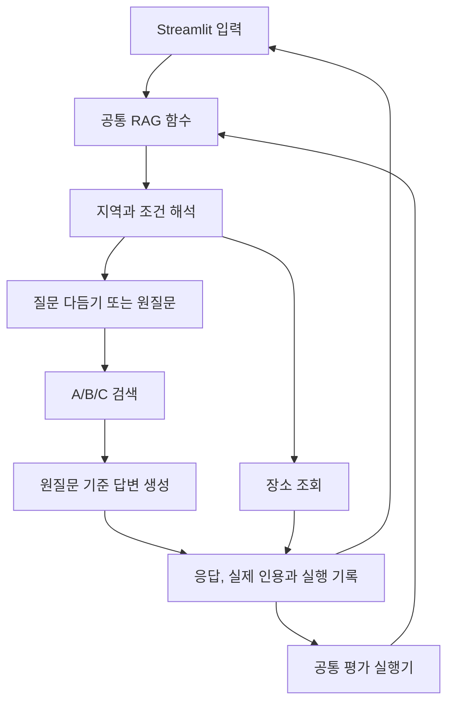

# 폴더 구조와 책임

현재 PR은 병렬 작업을 시작할 폴더를 마련한다. 기능 파일, 공통 타입과 실행 함수는 각 담당자가 구현하며, 아래 구조는 내부 파일 개수나 구현 순서를 제한하지 않는다.

## 폴더 배치

```text
.
├─ .github/                  PR, 의존성 갱신과 자동 검사
├─ .streamlit/               Streamlit 설정
├─ configs/                  수집, 파이프라인과 평가 설정
├─ prompts/                  생성과 질문 다듬기의 프롬프트
├─ src/                      공통 설정, 규격, 런타임, 파이프라인과 검증
│  ├─ ingestion/             수집과 정제, 로더, 청킹과 색인
│  ├─ query/                 별칭과 질문 다듬기
│  ├─ retrieval/             A/B/C 검색, 지역 해석, 장소 저장과 조회
│  ├─ generation/            근거 기반 생성과 응답 정책
│  ├─ infrastructure/        저장소, 임베딩과 외부 자원 연결
│  ├─ interface/             Streamlit 화면, 지도와 관찰 패널
│  ├─ evaluation/            공통 실행기, 담당별 지표와 비교 분석
│  └─ observability/         실행 원본 기록과 Langfuse 연결
├─ scripts/                  수집, 색인과 평가 명령
├─ data/
│  ├─ raw/                   수집 원문과 장소 원자료
│  ├─ processed/             정제 문서, 청크와 장소 자료
│  └─ indexes/               재생성 가능한 색인
├─ eval/                     개발셋과 최종셋, 정답과 허용 근거
├─ results/                  실행별 원본과 평가 결과
├─ tests/
│  ├─ unit/                  외부 연결을 대체한 동작 검사
│  ├─ integration/           모듈과 실제 외부 서비스 연결 검사
│  └─ fixtures/              합성 여부를 표시한 작은 검증 자료
└─ docs/                     팀 공통 기준과 재현 문서
```

Streamlit 진입점은 구현할 때 루트 `app.py`에 둔다. 화면 코드는 `src/interface/`에 두고 공통 RAG 함수를 호출한다. 현재 `app.py`와 기능 코드는 없다. Python 패키지가 필요한 폴더에는 첫 구현과 함께 `__init__.py`를 둔다.

## 담당 경로

| 담당 업무 | 주요 위치 | 다른 담당자와 맞출 경계 |
| --- | --- | --- |
| 데이터 수집과 질문 정제 담당자(이정은) | `src/ingestion/`의 수집과 정제, `src/query/`, 수집 설정과 별칭 자료 | 문서와 getSpot 원자료, 원질문 및 변환 질의의 인계 |
| 검색과 지역 및 장소 조회 담당자(이명지) | `src/retrieval/`, `src/evaluation/`의 검색 지표 | 지역 해석, A/B/C 후보, 장소 DB 저장과 조회, Hit@5 |
| 답변 생성과 품질 추적 담당자(강성수) | `src/generation/`, `src/evaluation/`의 Ragas 평가, `src/observability/`의 Langfuse 연결 | 응답 정책, 실제 입력과 인용, 개발문항 초안과 답변 평가 |
| 화면과 관찰 검증 담당자(이승주) | `src/interface/`, `app.py`, `.streamlit/`, 공용 검증과 비교 분석 | 지도, 상태 표시, 순위와 인용 관찰, 최종 평가셋 관리 |
| 공통 기반과 통합 담당자(양석호) | `src/` 공통 기반, `src/ingestion/`의 로더/청킹/색인, `src/infrastructure/`, 공통 평가 실행기와 원본 저장 | 호출 규격, 런타임과 버전, 전체 파이프라인과 재현 |

`src/ingestion/`, `src/evaluation/`와 `src/observability/`는 책임이 나뉜 공유 영역이다. 같은 폴더의 모든 기능을 한 담당자의 업무로 보지 않는다. 코드를 만들 때 파일별 책임을 구분하고 각 담당자의 내부 로직을 통합 코드에 복제하지 않는다.

## 연결 원칙



이 도식은 기능의 연결을 나타낸다. 필요한 조건을 되묻거나 오류를 처리하는 분기는 [공통 연결 기준](TEAM-SETUP.md)을 따른다. 장소 조회와 문서 검색의 결과 형식은 분리한다.

통합 코드는 검색과 생성 모듈의 공용 호출 지점을 사용한다. 내부 파일 분리와 알고리즘 선택은 각 담당자가 정하며, 공용 입출력, 의존성, DB 구조와 실행 기록 변경은 사용하는 담당자와 맞춘다.

평가셋과 실행 결과의 관리 원칙은 [eval](../eval/README.md), [results](../results/README.md)에 둔다. `eval/`의 정답과 `results/`의 결과를 수집 자료나 검색 색인으로 사용하지 않는다.
